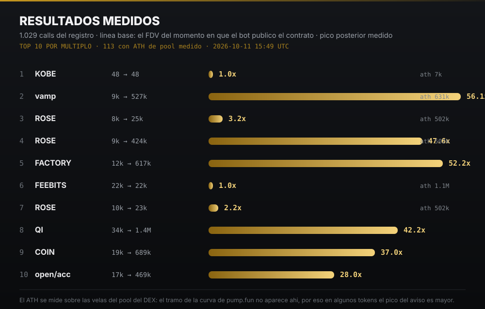

# Argos — Memecoin sniper (Solana)

Sistema de análisis on-chain para Solana. Reconstruye grupos de wallets que operan de forma coordinada en
lanzamientos de pump.fun, a partir de las compras registradas en la blockchain. No utiliza listas externas
de wallets ni servicios de pago: el agrupamiento surge de coincidencias temporales entre compras.

Alcance: sistema de observación. No ejecuta operaciones, no administra claves privadas y no tiene acceso a
fondos.


## Resultados medidos

Va primero porque es lo que importa. Cada call se mide desde el FDV del momento en que el bot
publicó el contrato (`mcap_call`) hasta el pico posterior registrado, y se completa con el máximo
histórico del pool.



Los mismos datos, en tabla:

| # | token | aviso | pico | múltiplo | ATH del pool |
|---|---|---|---|---|---|
| 1 | **vamp** | 9k | 527k | **56.1x** | 631k |
| 2 | **FACTORY** | 12k | 617k | **52.2x** | — |
| 3 | **ROSE** | 9k | 424k | **47.6x** | 502k |
| 4 | **QI** | 34k | 1.4M | **42.2x** | — |
| 5 | **COIN** | 19k | 689k | **37.0x** | — |
| 6 | **open/acc** | 17k | 469k | **28.0x** | — |
| 7 | **STRKT** | 10k | 233k | **23.8x** | — |
| 8 | **TOLLTROLL** | 9k | 209k | **22.3x** | — |
| 9 | **REA** | 9k | 187k | **21.1x** | — |
| 10 | **kumo** | 8k | 146k | **19.3x** | — |

_El ATH se mide sobre las velas del pool; el tramo de la curva de pump.fun no está ahí, así que en algunos tokens el pico del aviso es mayor._

## Pipeline

1. **Ingesta.** Consulta los lanzamientos recientes de pump.fun y extrae hasta 40 compradores por
   lanzamiento, con monto y timestamp de cada compra.
2. **Agrupamiento.** Para cada token se consideran las compras dentro de una ventana de 300 segundos. Dos
   wallets se vinculan cuando coinciden en al menos dos lanzamientos distintos. La vinculación se resuelve
   con union-find con compresión de caminos.
3. **Atribución de origen.** Para cada grupo se reconstruye la cadena de fondeo hasta seis saltos atrás,
   con el fin de identificar la wallet que originó los fondos.
4. **Detección en vivo.** Suscripción WebSocket con `logsSubscribe` filtrado por `mentions` del mint. La
   ventana de ráfaga es de 150 segundos, con umbral de 2 wallets y 0,1 SOL por operación.
5. **Evaluación.** Cada aviso se contrasta con las velas posteriores: FDV al momento del aviso contra el
   máximo posterior, sobre una ventana de 6 horas.
6. **Control.** Ejecución paralela de un test con tokens aleatorios, medidos bajo los mismos criterios.

## Parámetros de agrupamiento

| parámetro | valor | criterio |
|---|---|---|
| ventana de co-compra | 300 s | amplitud suficiente para captar la coordinación, acotada para excluir compras no relacionadas |
| coincidencias mínimas | 2 lanzamientos | umbral fijo: una coincidencia aislada no permite inferir vinculación |
| compradores por lanzamiento | 40 | mayor cantidad de pares candidatos por token |
| monto mínimo por comprador | 0,1 SOL | descarta transferencias de polvo que degradan el grafo |
| tamaño mínimo de cohorte | 2 wallets | el agrupamiento parte de pares y crece por transitividad |

Una coincidencia en un lanzamiento con 40 compradores aporta poca información; la misma coincidencia en un
lanzamiento con 3 compradores es altamente discriminante. El sistema no aplica esa ponderación de forma
explícita: la obtiene de la frecuencia relativa de cada par a lo largo de varios lanzamientos.

## Implementación

Librería estándar de Python y APIs públicas. Sin modelos de lenguaje ni heurísticas opacas: los criterios
están declarados en el código.

- **Lectura on-chain.** `getSignaturesForAddress` y `getTransaction` con `encoding: jsonParsed` sobre RPC
  público, con paginado y caché. La reconstrucción profunda de una wallet se resolvió en una única pasada:
  el esquema anterior descargaba cada transacción dos veces (flujos y tokens), lo que volvía inviable el
  análisis de historiales extensos.
- **Tiempo real.** `logsSubscribe` con `mentions: [mint]` sobre WebSocket, con ping cada 20 segundos. La
  ráfaga se detecta durante el bloque en que se produce, sin esperar la siguiente pasada programada.
- **Concurrencia.** El estado es escrito por cuatro procesos (radar cada 5 minutos, patrulla cada 3,
  muestreo cada 5, comandos cada minuto). La escritura a un archivo temporal seguida de rename resulta
  insuficiente: el punto crítico es el ciclo completo de lectura, modificación y escritura, que se
  serializa con `flock`. Los temporales incorporan el pid en el nombre.
- **Cupo de API.** Cada corrida registra su consumo, de modo que el gasto se mide desde el propio sistema y
  no desde el panel del proveedor. Las credenciales residen fuera del repositorio.
- **Verificación de entrega.** El envío a Discord se comprueba releyendo el canal: una respuesta 200 del
  POST no garantiza que el mensaje sea visible para el usuario.

## Hallazgos

Corresponden a las mediciones registradas en `NOTAS.md`. Se incluyen los resultados negativos.

- **Rentabilidad de insiders.** Sobre 15 wallets auditadas con historial profundo y 16 tokens que
  registraron movimientos significativos, no se observó rentabilidad sostenida en ninguna wallet que
  hubiera recibido tokens sin pago en el lanzamiento y los hubiera vendido después.
- **Patrón de distribución masiva.** Tres lanzamientos independientes presentaron el mismo saldo exacto
  (7.381 SOL) y distribuyeron tokens a 372, 354 y 339 wallets respectivamente. La coincidencia exacta del
  saldo indica un único operador con servicio de lanzamiento y una wallet nueva por token. La distribución
  se dirige a cuentas sin actividad posterior, por lo que no representa demanda orgánica.
- **Desempeño de grupos grandes.** Un grupo de 9 wallets con 31 SOL acumulados alcanzó un máximo de 24x y
  una mediana de 0,46x. El máximo aislado no es representativo del desempeño del grupo.
- **Top holders de RugCheck.** El listado incluye la curva de pump.fun, que en un token reciente
  representa entre el 94% y el 100% del supply. Sin descontarla, todo token nuevo aparece con una
  concentración del 100% en las primeras diez posiciones.

```diff
+ máximo del grupo de 9 wallets:               24x
- mediana del mismo grupo:                    0,46x
- insiders con rentabilidad sostenida:         0 de 15
+ wallets alcanzadas por el operador:          372 / 354 / 339
- volumen de 24 h que descalifica:             500 USD
+ lanzamientos requeridos por par:             2
```

## Metodología de evaluación

- **Rango de medición.** FDV al momento del aviso contra el máximo posterior, con una ventana de 6 horas.
- **Estadístico principal.** Mediana. Un valor extremo aislado altera el promedio sin representar el
  comportamiento del conjunto.
- **Puntaje.** Percentil diario, de modo que la escala se recalibra con el mercado en lugar de acumular
  valores históricos.
- **Tamaño mínimo de muestra.** Para puntuar una wallet se requieren 1.000 transacciones leídas y 30
  posiciones cerradas. Muestras menores producen estimaciones de rentabilidad no reproducibles.
- **Referencia de control.** El test con tokens aleatorios establece la línea base contra la cual se compara
  el desempeño del sistema.

## Estructura

Ingesta y agrupamiento:

| archivo | función |
|---|---|
| `cohortes.py` | cosecha de lanzamientos, agrupamiento con union-find, atribución de origen y clasificación |
| `pump_analizador.py` | análisis de un token y emisión del veredicto con sus banderas |
| `grupos_onchain.py` | consulta de las compras de un grupo sin pertenecer a él |

Forense y detección de insiders:

| archivo | función |
|---|---|
| `wallet_forense.py` | reconstrucción del origen y destino de los fondos de una dirección |
| `forense_profunda.py` | misma reconstrucción en una pasada con caché, para historiales extensos |
| `insiders_cruce.py` | detección por cruce: recepción sin pago en el lanzamiento y venta posterior |
| `cazar_fantasmas.py` | cruce de vendedores contra receptores sin pago, para separar creador de compradores |
| `red_wallets.py` | extracción y puntuación de las wallets conectadas a una dirección |

Detección en vivo:

| archivo | función |
|---|---|
| `vigilante_calls.py` | suscripción WebSocket: detección de la ráfaga durante el bloque |
| `vigilante_copiable.py` | aviso en la compra de una wallet con desempeño validado, con límite por hora |
| `calls_detector.py` | detección de ráfagas para el radar |

Evaluación:

| archivo | función |
|---|---|
| `registro_calls.py` | registro y evaluación posterior de cada aviso, para recalibración |
| `control_test.py` | test de control sobre tokens aleatorios |
| `tabla_calls.py` | tabla de resultados del período |
| `consumo.py` | consumo de API medido desde el sistema |

Infraestructura:

| archivo | función |
|---|---|
| `comando_discord.py` | comandos de chat del sistema |
| `canal_wallets.py` | atención automática del canal de auditoría |
| `jsonio.py` | escritura serializada con `flock` para los cuatro procesos concurrentes |
| `ops/guardia_memoria.py` | vigilancia de memoria: avisa y corta jobs antes de que el kernel mate el gateway |
| `ops/crontab-con-limites.txt` | líneas de cron con `flock`, `timeout` y `prlimit` |
| `ops/hermes-gateway-oom.conf` | drop-in de systemd con `OOMScoreAdjust=-500` para el gateway |
| `docs/incidente-oom-2026-10-18.md` | registro del incidente de memoria y de sus límites |
| `NOTAS.md` | registro completo de las mediciones, incluidos los resultados negativos |

## Límites de recursos

Los jobs de cron tardan más que su intervalo, así que sin control se apilan. El 18 de octubre de 2026 eso
terminó en 84 procesos simultáneos, load 42, swap al 100 % y el gateway muerto por el OOM killer.

Cada job pesado corre ahora con `flock -n` (un lock propio), `timeout` de 600 a 900 segundos y
`prlimit --as=1.5 GiB`; el gateway lleva `OOMScoreAdjust=-500` para no ser el primero en la lista del
kernel, y una guardia revisa la memoria cada 3 minutos. Detalle y evidencia en
[`docs/incidente-oom-2026-10-18.md`](docs/incidente-oom-2026-10-18.md).

## Criterios fijos

- **1.000 transacciones y 30 posiciones cerradas** como mínimo para puntuar una wallet.
- **Dos coincidencias** para establecer un vínculo entre wallets. El umbral no se reduce para aumentar el
  volumen de señales.
- **Volumen de 24 h inferior a 500 USD** descalifica un token, con independencia de su liquidez.
- **La primera pasada sobre una wallet nueva registra línea base** sin emitir avisos.
- **Filtro de polvo** en todas las lecturas: las wallets reciben micro-transferencias constantes (del orden
  de 0,000005 SOL) que carecen de valor analítico.
- **La mediana determina el desempeño.** El máximo no se utiliza como métrica de resultado.

## Uso

© COEFR. Uso personal. El contenido es informativo y no constituye asesoría financiera. Referencia de
contexto: el 76% de los tokens nuevos de Solana termina en rug.
