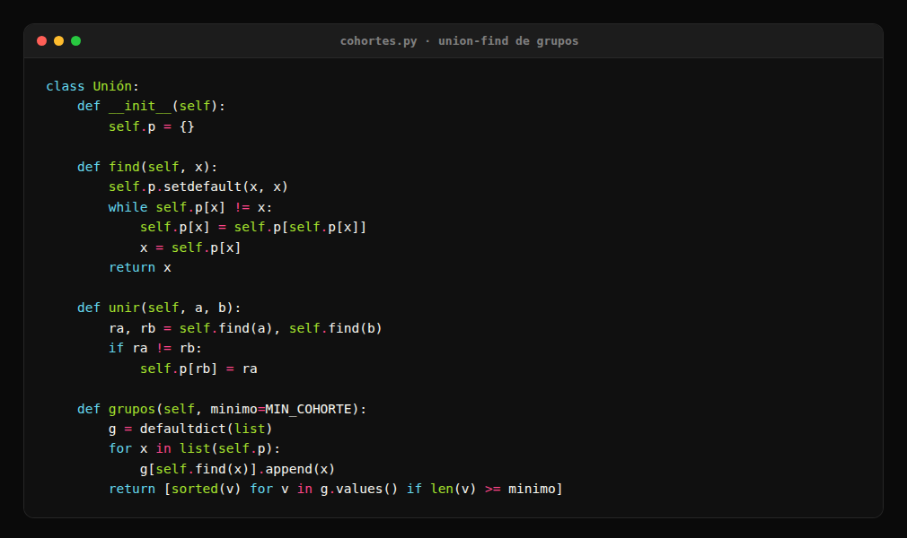

# Argos — inteligencia on-chain de memecoins (Solana)

Argos, el gigante de los cien ojos, no dejaba de mirar. Esto hace lo mismo con la blockchain de Solana:
lee los lanzamientos de pump.fun, anota quién compró cada uno y a qué segundo, y con esas coincidencias
encuentra los grupos de wallets que vienen comprando juntas desde antes de que el token sea noticia. Sin
grupos de pago, sin listas de KOLs, sin pedirle permiso a nadie.

El circuito completo:

1. **Cosecha.** Cada pasada baja los lanzamientos nuevos de pump.fun y, para cada uno, la lista de
   compradores con su monto y el segundo exacto en que entraron. Si un lanzamiento tiene 400 compradores,
   se bajan los 400.
2. **Agrupa.** Las wallets que coinciden en dos o más lanzamientos distintos se unen por union-find. El
   resultado no son listas compradas: son conjuntos que aparecieron solos.
3. **Rastrea el origen.** Para cada grupo se busca la wallet que lo fondeó y de dónde salió esa plata,
   seis saltos hacia atrás. Con eso se separa un grupo de personas de una granja de bots con un mismo
   pagador.
4. **Vigila en vivo.** Un WebSocket queda suscrito a las wallets que dieron resultado. Cuando una compra,
   el aviso sale en segundos, no en la pasada siguiente.
5. **Mide.** Cada aviso se evalúa después: el FDV del momento contra el pico que vino. Los grupos se
   ordenan por resultado real, no por promesa.
6. **Controla.** En paralelo corre un test con tokens frescos al azar, medidos exactamente igual. Si el
   sistema no le gana al azar, no sirve, y eso tiene que poder verse.

Solo informa. No opera, no mueve fondos y no pide claves privadas. Los datos y las claves quedan fuera del
repositorio.

## Cómo encuentra un grupo sin que se lo cuenten

El corazón son treinta líneas: una clase con union-find. Cada wallet que compró un lanzamiento se une con
las que coincidieron en ese mismo token y en otro distinto. Treinta líneas, y ningún dato comprado.

Lo interesante no es la estructura de datos, es el criterio. **Una coincidencia no alcanza**: dos wallets
comprando el mismo token pueden ser casualidad, o dos bots del mismo dueño. Se exigen dos lanzamientos
distintos como mínimo, y cuanto más raro es el token, más pesa la coincidencia. Coincidir donde compraron
cuarenta personas no dice nada; coincidir donde compraron tres, dice casi todo.

Después viene la parte que casi nadie hace: **de dónde salió la plata**. Se sigue el fondeo seis saltos
atrás hasta dar con la wallet que pagó, y ahí se cae la máscara: dos grupos que parecían independientes
suelen terminar con el mismo pagador, y lo que parecía una comunidad es una granja con varios sombreros.

## Qué encontró

Esta sección va antes de la estructura a propósito. Todo medido, nada estimado:

- **Insiders rentables: cero.** Quince wallets auditadas con historial profundo sobre dieciséis tokens que
  habían despegado. Ninguna de las que recibió tokens gratis y después vendió terminó ganando de forma
  sostenida. La información privilegiada existe; el talento para convertirla en plata no apareció.
- **El reparto masivo tiene firma propia.** Tres lanzadores distintos con el mismo saldo exacto (7.381
  SOL) repartiendo a 372, 354 y 339 wallets. No son tres proyectos: es un operador con servicio de
  lanzamiento y una wallet nueva por token. Y el reparto va a cáscaras sin una sola operación, así que no
  hay demanda detrás: esos tokens colapsan.
- **Grande no es sinónimo de bueno.** Un grupo de nueve wallets con 31 SOL juntos marcó un pico de 24x y
  una mediana de 0,46x. Cada tanto le pega a una y el resto del tiempo pierde: son snipers entretenidos,
  no inversores.
- **Los top holders de RugCheck engañan a cualquiera.** Incluyen la curva de pump.fun, que en un token
  recién lanzado es el 94-100% del supply. Sin descontarla, todo token nuevo parece un rug con el "top 10
  al 100%". Es el error más común de las herramientas que puntúan tokens.

## Cómo se mide, y por qué vale creerle

Un sistema que se autoevalúa tiene que decir con qué vara mide:

- **FDV del momento contra el pico posterior.** La misma cuenta que hace Rick con `/ga`: sirve para saber
  si hubo profit después del aviso, no para decorar un canal.
- **Mediana antes que promedio.** Un 24x perdido entre veinte fracasos mueve el promedio y no cambia nada
  de lo que pasó. La mediana sí.
- **Puntaje por percentil del día**, no por suma acumulada: el ranking se autocalibra cuando el mercado
  cambia de humor, en vez de quedar pegado a los números de la semana pasada.
- **La ventana corta miente.** Para puntuar una wallet se exigen mil transacciones leídas y treinta
  posiciones cerradas. Con menos, aparece rentabilidad que no existe.
- **Índice contra el azar.** El test de control corre con tokens al azar, medidos igual. Sin esa
  comparación, cualquier racha parece mérito.

## Estructura

Cosecha y grupos:

| archivo | qué hace |
|---|---|
| `cohortes.py` | cosecha los lanzamientos, arma los grupos con union-find, busca el origen y los clasifica |
| `pump_analizador.py` | analiza un token y devuelve el veredicto con sus banderas |
| `grupos_onchain.py` | ve las compras de los grupos sin entrar a ningún grupo |

Forense e insiders:

| archivo | qué hace |
|---|---|
| `wallet_forense.py` | le pasás una dirección y cuenta de dónde vino la plata y a dónde fue |
| `forense_profunda.py` | la misma forense en una pasada con caché, para wallets de miles de transacciones |
| `insiders_cruce.py` | insiders por cruce: quién recibió gratis en el lanzamiento y después vendió |
| `cazar_fantasmas.py` | cruza quién vende contra quién recibió gratis, para separar al dev de los compradores |
| `red_wallets.py` | saca las wallets conectadas a una dirección y las puntúa |

Vigilancia en vivo:

| archivo | qué hace |
|---|---|
| `vigilante_calls.py` | WebSocket: detecta la ráfaga de compras en segundos |
| `vigilante_copiable.py` | avisa apenas una wallet que sirve compra algo |
| `calls_detector.py` | detector de ráfagas para el radar |

Medición:

| archivo | qué hace |
|---|---|
| `registro_calls.py` | guarda cada aviso y lo evalúa después, para recalibrar con datos reales |
| `control_test.py` | el test de control contra tokens al azar |
| `tabla_calls.py` | la tabla de resultados, la misma cuenta que hace Rick con `/ga` |
| `consumo.py` | cuánto cupo de Helius se gastó y cuánto queda, sin abrir el panel |

Discord e infraestructura:

| archivo | qué hace |
|---|---|
| `comando_discord.py` | los comandos de chat del sistema |
| `canal_wallets.py` | escucha el canal de auditoría y contesta solo |
| `jsonio.py` | escritura atómica de JSON, segura entre procesos: dos cron a la vez no se pisan |
| `NOTAS.md` | todo lo medido, incluidas las cosas que no funcionaron |

## Reglas que no se negocian

Salieron de errores reales, no de manuales:

- **Mil transacciones y treinta posiciones cerradas** antes de puntuar una wallet. La ventana corta miente,
  siempre.
- **Volumen de 24 h menor a 500 USD descalifica** un token, por linda que sea su liquidez: no hay a quién
  venderle.
- **La primera pasada de una wallet nueva es línea base.** Se anotan sus firmas sin avisar. Sin eso se
  publican diez avisos de historial viejo y el canal se vuelve ruido.
- **Filtro de polvo obligatorio.** Las wallets reciben micro-transferencias constantes de 0,000005 SOL.
  Sin exigir un movimiento mínimo, el tracker llena el canal de avisos que no significan nada.
- **Una coincidencia no es un grupo, y un pico no es un resultado.** Las dos reglas que sostienen todo lo
  demás.

## Licencia

© COEFR. Uso personal. Nada de esto es asesoría financiera, y el 76% de los tokens nuevos de Solana
termina en rug: los datos están para decidir con umbrales, no con entusiasmo.
